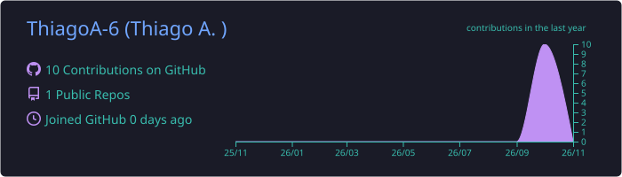
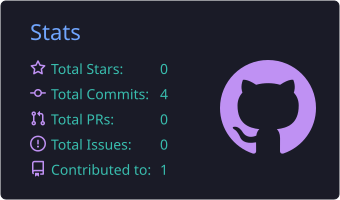
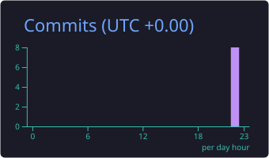

  

  
  
  

<h2 align="center">🧑‍💻 Sobre mim</h2>

  

<h2 align="center">🛠️ Tecnologias</h2>

<b>Estudando</b>

  

<b>Ferramentas</b>

  

<h2 align="center">📊 Estatísticas</h2>

  

  
  

  

<h2 align="center">🐍 Contribuições</h2>

  <picture>
    <source media="(prefers-color-scheme: dark)" srcset="https://raw.githubusercontent.com/ThiagoA-6/ThiagoA-6/output/github-snake-dark.svg" />
    <source media="(prefers-color-scheme: light)" srcset="https://raw.githubusercontent.com/ThiagoA-6/ThiagoA-6/output/github-snake.svg" />
    
  </picture>

<h2 align="center">🎯 Metas</h2>

| Meta | Status |
| :-- | :-: |
| 📦 Publicar meu primeiro projeto no GitHub | 🔄 Em andamento |
| 🌐 Criar um site de portfólio | ⏳ Em breve |
| 🤝 Contribuir com um projeto open source | ⏳ Em breve |

  

  

